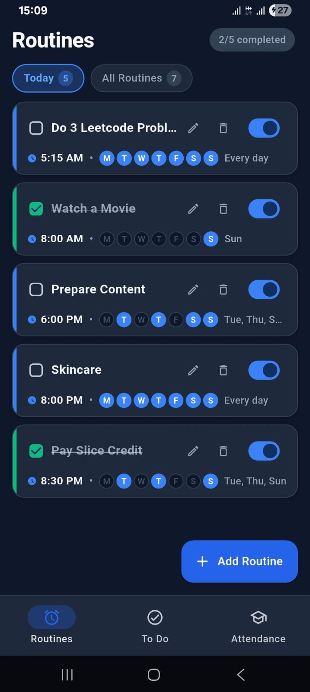
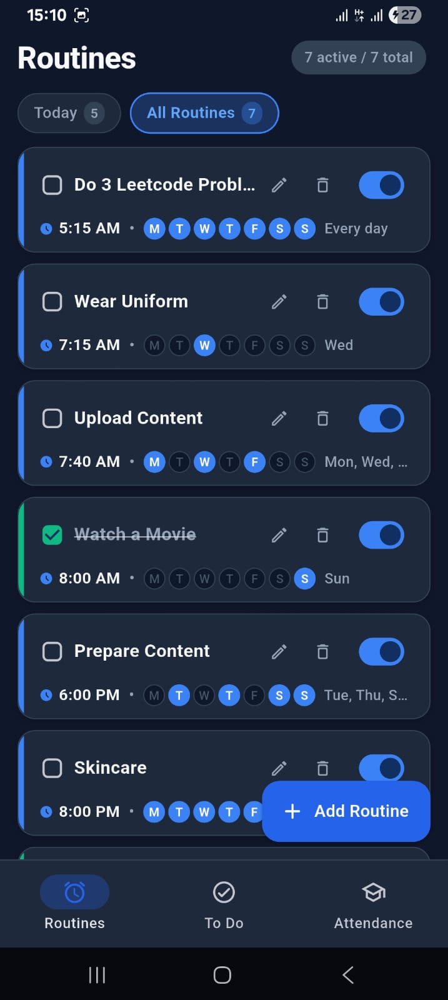
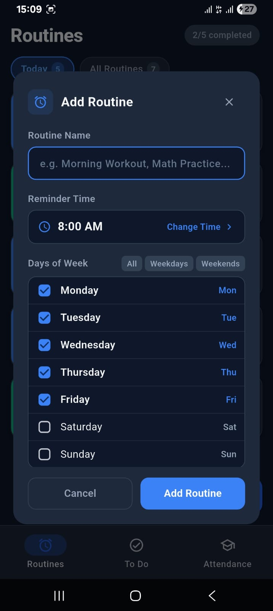
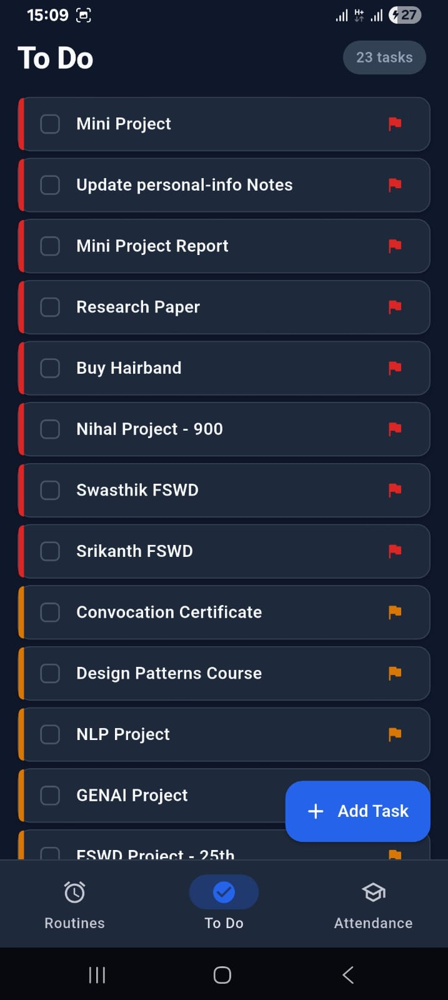
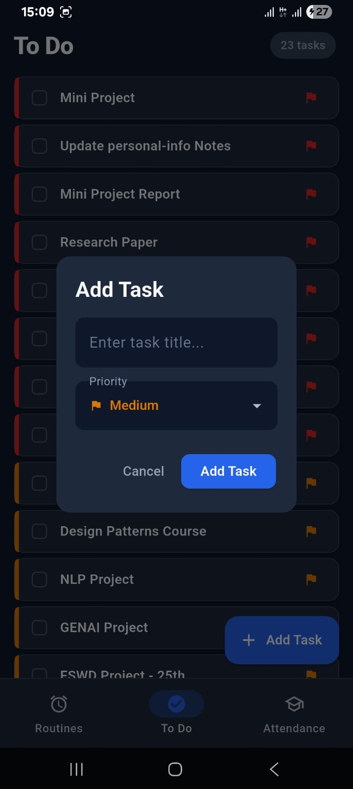
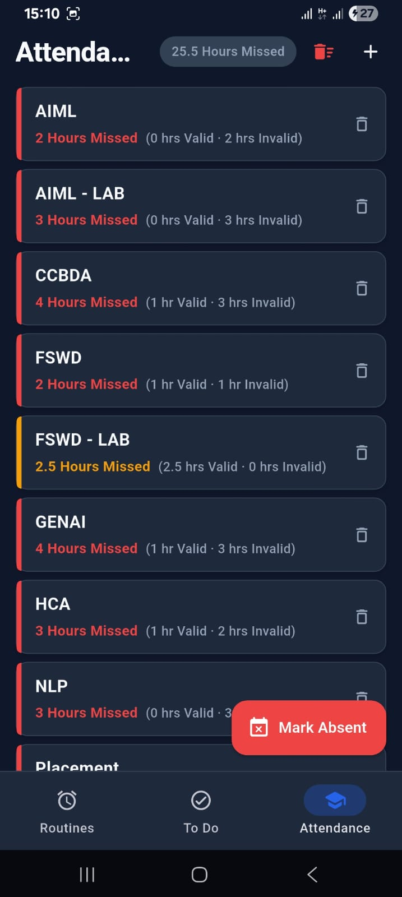
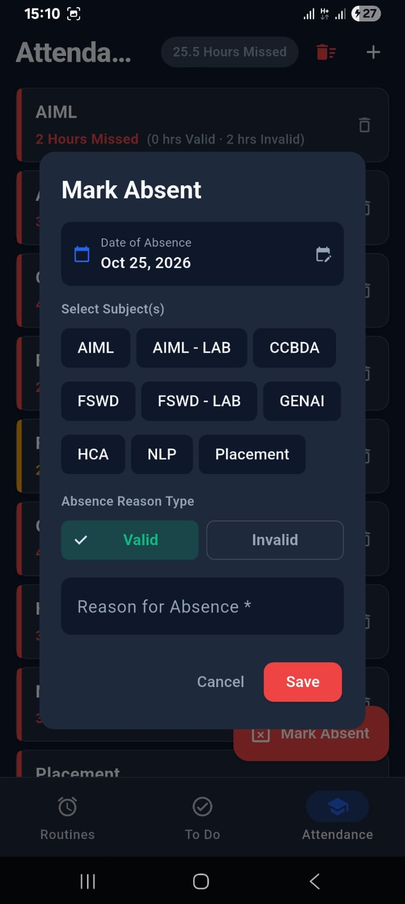
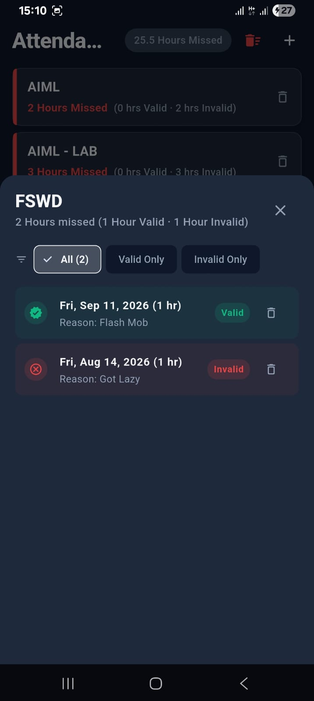

# 🎓 Campus Flow

Campus Flow is an **all-in-one student productivity and routine management app** built with Flutter and native Android integration.
Students can track daily routines with reminders, manage priority-based to-dos, and log college attendance, with live Android home screen widgets that stay in sync with the app.

---

## 📸 Screenshots

|  |  |  |  |
|:--:|:--:|:--:|:--:|

|  |  |  |  |
|:--:|:--:|:--:|:--:|

> 🖼️ Click on any image to view it in full size.

---

## ✨ Features

* ⏰ **Routines & Reminders:** Recurring daily or weekday schedules with exact-time audible and vibration alerts.
* 🔄 **Automatic Daily Reset:** Routine check-offs reset themselves each day, with no background worker needed.
* ✅ **Priority To-Do Manager:** Tasks ranked `High`, `Medium`, or `Low`, auto-sorted with incomplete tasks first.
* 📊 **Attendance Tracker:** Log missed classes by subject and hours, and classify absences as valid (excused) or invalid (unexcused).
* 🔍 **Detailed Attendance Logs:** Per-subject breakdown with `All`, `Valid Only`, and `Invalid Only` filters.
* 🛡️ **Delete Safety Guard:** A 5-second countdown before subjects can be deleted, to prevent accidents.
* 📱 **Android Home Screen Widgets:** Tick tasks and routines straight from your home screen, with bi-directional sync.
* 🌗 **Modern Material 3 UI:** Light and dark themes, responsive layouts for tablets and foldables.
* 📴 **Offline-First:** All data is stored locally on the device.

---

## 🚀 Tech Stack

* **Framework:** Flutter (Material 3), SDK `^3.12.2`
* **Languages:** Dart and Kotlin (Android SDK 34+)
* **Local Storage:** `shared_preferences` and native Android `SharedPreferences`
* **Notifications:** `flutter_local_notifications` with `timezone` and `flutter_timezone`
* **Native Interop:** `MethodChannel` (`campus_flow.widget_sync`) for widget ↔ app sync
* **Testing & Linting:** `flutter_test`, `flutter_lints`

---

## 🛠️ Setup Instructions

### Prerequisites

* Flutter SDK 3.12+
* Android SDK (API 34+) with Kotlin support
* Java 17+

Clone the repository and get started!

```bash
# 1. Clone the repo
git clone https://github.com/programmingwithshishir/campus_flow.git
cd campus_flow

# 2. Install dependencies
flutter pub get

# 3. Run the app on a connected device or emulator
flutter run
```

### Other Useful Commands

```bash
# Run the test suite
flutter test

# Analyze the code for lint issues
flutter analyze

# Build a release APK
flutter build apk --release
```

---

## 🗄️ Data Storage

Campus Flow needs no external database. Data is serialized to JSON and stored in Android's native `SharedPreferences` (`campus_flow_widget_store`), so both the Flutter app and the home screen widgets can read and write it.

| Key | Contents |
|:--|:--|
| `tasks` | To-do items with priority, completion state, and creation time |
| `routines` | Routines with time, weekdays, enabled flag, and last completed date |
| `attendance` | Subjects and their absence records |

### Widget Sync

```
Widget checkbox tap ──► Provider updates SharedPreferences ──► MethodChannel signal ──► Flutter UI refreshes
In-app edit         ──► Storage saves via MethodChannel    ──► AppWidgetManager     ──► Widgets refresh
```

The app also reloads its data whenever it resumes from the background, so the two sides never drift apart.

---

## 🧩 Project Structure

```
campus_flow/
├── android/                    # Native Android code & AppWidget providers (Kotlin)
├── assets/images/              # App logo and branding
├── lib/
│   ├── app.dart                # Root MaterialApp and Light/Dark themes
│   ├── main.dart               # Entry point
│   ├── core/                   # Widget sync service
│   ├── pages/                  # Bottom navigation (Routines, To Do, Attendance)
│   └── features/
│       ├── attendance/         # Absence tracking (data, models, pages)
│       ├── routines/           # Routines & notification scheduling
│       └── tasks/              # Priority to-do management
├── test/                       # Unit and widget tests
├── pubspec.yaml
└── analysis_options.yaml
```

---

## 🧪 Testing

The `test/` directory covers:

* **`task_item_test.dart`:** Priority and creation-date sorting.
* **`routines_test.dart`:** Time formatting, JSON serialization, dialog validation, navigation, and daily completion reset.
* **`widget_test.dart`:** End-to-end task creation, completion, and deletion flows.

---

## 🗺️ Roadmap

* ☁️ Cloud sync and backup (e.g. Firebase or Supabase)
* 📉 Attendance threshold alerts (e.g. 75% rule)
* 🔥 Routine habit streaks and completion history
* 🍎 iOS home screen widgets via WidgetKit
